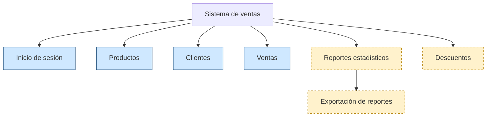

# Modelo de características

| Característica | Tipo | Requiere | Básica | Premium |
|---|---|---|---|---|
| Inicio de sesión | Obligatoria | — | Sí | Sí |
| Productos | Obligatoria | auth | Sí | Sí |
| Clientes | Obligatoria | auth | Sí | Sí |
| Ventas | Obligatoria | productos, clientes | Sí | Sí |
| Reportes estadísticos | Opcional | ventas | No | Sí |
| Gestión de descuentos | Opcional | ventas | No | Sí |
| Exportación de reportes | Opcional | reportes | No | Sí |

Mecanismos de variabilidad: archivos de configuración `config/variants/*.json`, variable de entorno `VARIANT` y sobrescritura `FEATURE_<NOMBRE>=true|false`. La validación automatizada está en `src/config.js` (`validateConfig`) y se ejecuta en CI.
